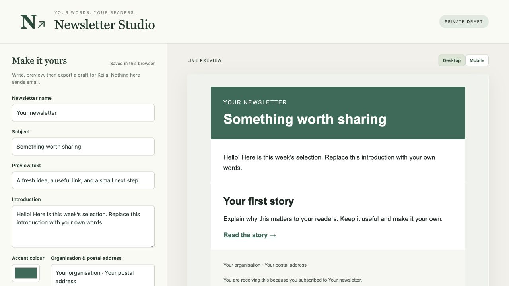

# Your own newsletter, installed with an AI assistant

Build an independent newsletter system with **Keila + Amazon SES + a browser-based Newsletter Studio**. Give this repository URL to ChatGPT, Claude, Grok Bot, or another assistant and ask it to guide you through the installation.

This is a clean community starter inspired by The Future's newsletter workflow. It contains original, generic templates and installation instructions. It contains **no existing subscriber list, private newsletter content, personal email account, passwords, AWS account, or production configuration**.

## Start with this prompt

```text
Help me install my own newsletter system using:
https://github.com/robbertvanempel/newsletter-starter

Read README.md, AGENTS.md, INSTALL.md, and docs/aws-ses.md first.
Guide me in my preferred language, one verified phase at a time. If you have
browser or terminal tools, use them to carry out the setup I authorize.
Otherwise give exact click instructions and commands. First check which
tools you actually have. Use my own domain, server, branding and accounts.
Keep credentials out of this chat and all public files. Explain recurring
costs before purchases. Finish with a working Studio, Keila and Amazon SES,
a test newsletter I approve, signup/unsubscribe checks, and a backup.
Do not send a campaign to subscribers without my explicit approval.
```

An ordinary chat can explain the installation. An assistant with browser control can also navigate settings; terminal access lets it create files, run checks and deploy. **A URL alone does not grant an AI access to your computer or accounts.** You handle login, MFA, payment details and any confirmation the tool requires. AWS decides whether to grant SES production access; the assistant cannot guarantee approval.

## What you get

| Component | Purpose | Where your data lives |
| --- | --- | --- |
| [Newsletter Studio](studio/) | Edit branding, introduction and story blocks, reorder stories, add HTTPS images, preview desktop/mobile, export email HTML and Keila draft JSON | Draft in your own browser; editable JSON files you save |
| [Keila](https://www.keila.io/) | Contacts, signup forms, consent, campaigns, unsubscribe handling and statistics | PostgreSQL and uploads on your server |
| [Amazon SES](https://aws.amazon.com/ses/) | Deliver campaign emails; report bounces and complaints through SNS | Your own AWS account and chosen region |
| Docker Compose + Caddy | Run the services and obtain HTTPS certificates; protect Studio with its own login | Your server and persistent Docker volumes |
| [Draft importer](scripts/create_draft.py) | Create an unscheduled HTML draft using Keila's official API | Private import receipts on your machine; campaign in Keila |

The portable workflow is **Studio → export → import a draft → review and send in Keila**. Studio saves locally, not directly into Keila, and does not sync drafts between browsers. Edit the imported draft in Keila, or explicitly import a new revision from Studio; these are separate drafts. The private production installation's custom autosync, archive patches, signup gateway and dashboard integrations are not required or included. This starter uses unmodified upstream Keila.



## Choose your route

- **AI-guided installation:** paste the prompt above and follow [INSTALL.md](INSTALL.md).
- **Try the editor first:** clone or download this repository, run `python3 -m http.server 8787 --bind 127.0.0.1 --directory studio`, then open `http://127.0.0.1:8787`. No AWS account or subscriber data is needed to try it. Stop with Ctrl+C.
- **Already running Keila:** use Studio and follow [the draft workflow](docs/studio.md). You do not need to replace your existing server or proxy.

## Requirements and costs

Use your own domain with DNS access, an AWS account, and a Linux server with Docker Engine and Docker Compose v2. A small x86-64 server with 2 GB RAM is a practical starting point; verify capacity for your list and other workloads. The pinned image digests must support your server architecture; inspect them before using a different architecture. Python 3.10+ runs the helpers. Node 20+ is only needed for the JavaScript tests.

Keila and this starter are open source. Your server, domain, SES deliveries and possibly SNS, backups or other AWS services cost money. There is no fixed price or perpetual free-hosting promise. Review [SES pricing](https://aws.amazon.com/ses/pricing/), [SNS pricing](https://aws.amazon.com/sns/pricing/) and [AWS Budgets pricing](https://aws.amazon.com/aws-cost-management/aws-budgets/pricing/) for your region and account before provisioning. A budget alert **does not cap spending or stop email**.

## Read in this order

1. [AI assistant instructions](AGENTS.md) — capabilities, private inputs, checkpoints and acceptance checks.
2. [Installation](INSTALL.md) — domain, server, credentials, deployment and Keila setup.
3. [AWS SES and SNS](docs/aws-ses.md) — verified domain, IAM, SMTP, feedback and production access.
4. [Writing and importing an edition](docs/studio.md).
5. [Backups, restore, upgrades and troubleshooting](docs/maintenance.md).

## Version and verification

Baseline: **Keila 0.30.3, PostgreSQL 16, Caddy 2.11.7**, with pinned official image digests. Keila's environment variables, API payload and SES webhook route were checked against [upstream v0.30.3](https://github.com/pentacent/keila/tree/v0.30.3). This is a reproducible baseline, not a claim that these versions will stay current. Before a new installation, check upstream releases and security notices; test upgrades and keep a rollback backup.

Run local checks with:

```sh
node --test tests/*.test.mjs
python3 -m unittest discover -s tests
docker compose --env-file .env.example -f deploy/compose.yml config --quiet
```

An installation is ready only after **your own** HTTPS, login, draft, actual inbox, signup, unsubscribe, bounce/complaint and restore checks pass. See the exact checklist in [INSTALL.md](INSTALL.md#7-acceptance-checklist). A passing source test is not proof of SES approval or inbox delivery.

## License

Original starter code and documentation: [MIT](LICENSE). Keila is a separate [AGPLv3 project](https://github.com/pentacent/keila/blob/v0.30.3/LICENSE.md); its license and those of the other containers still apply. No Keila source code is bundled here.
